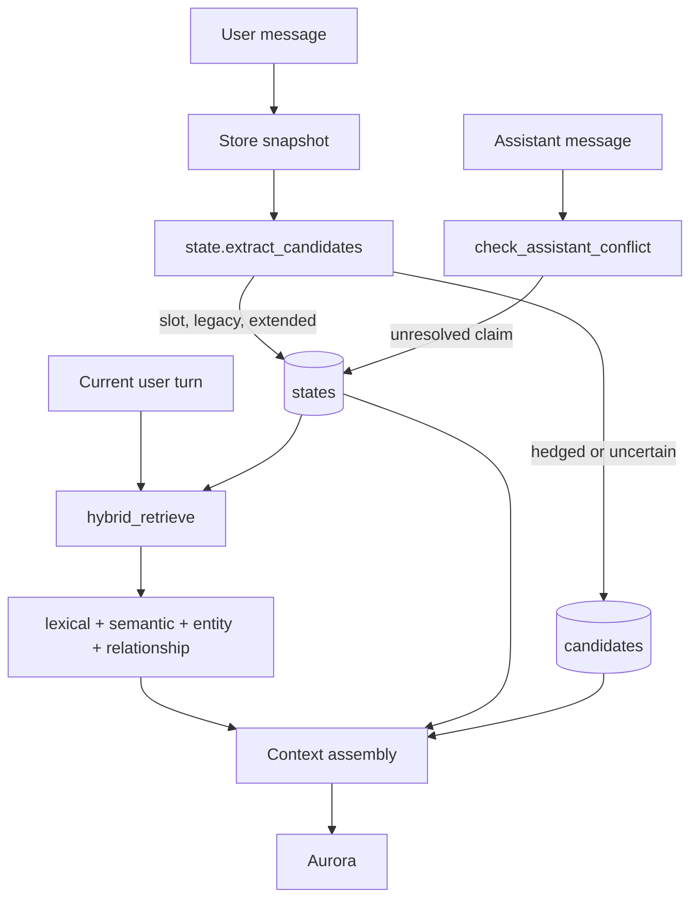
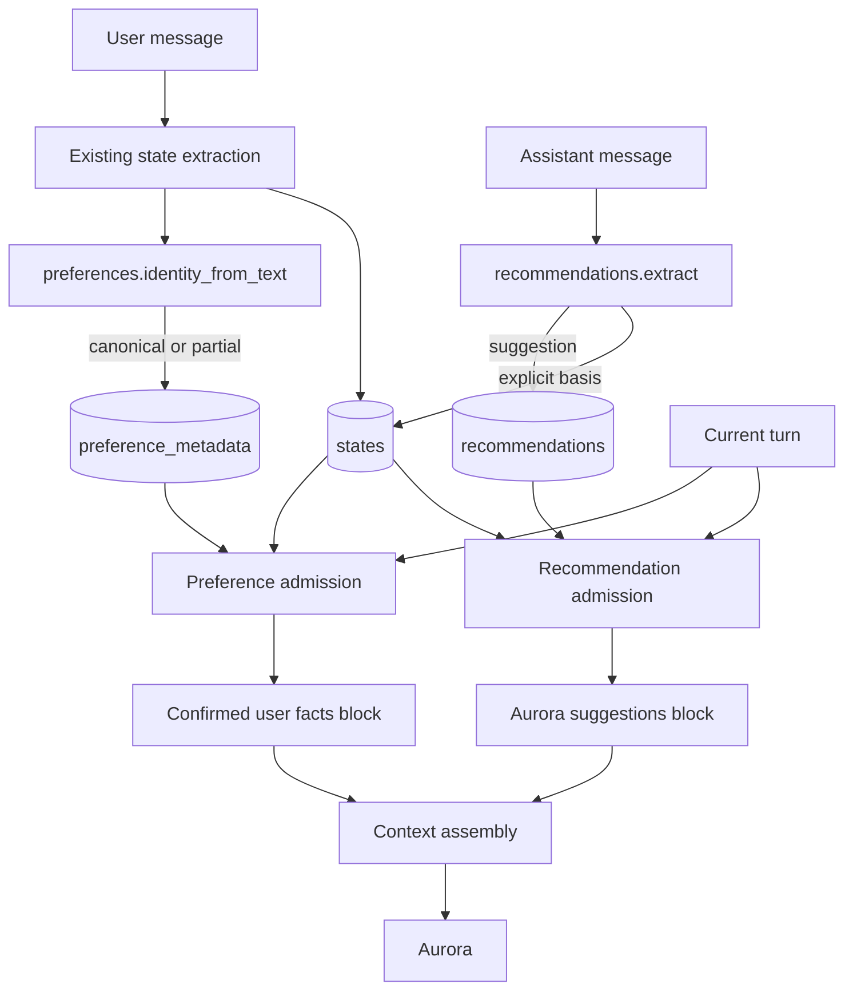
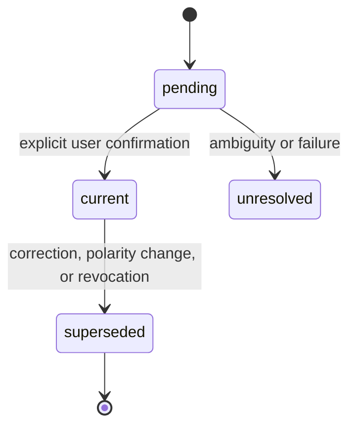
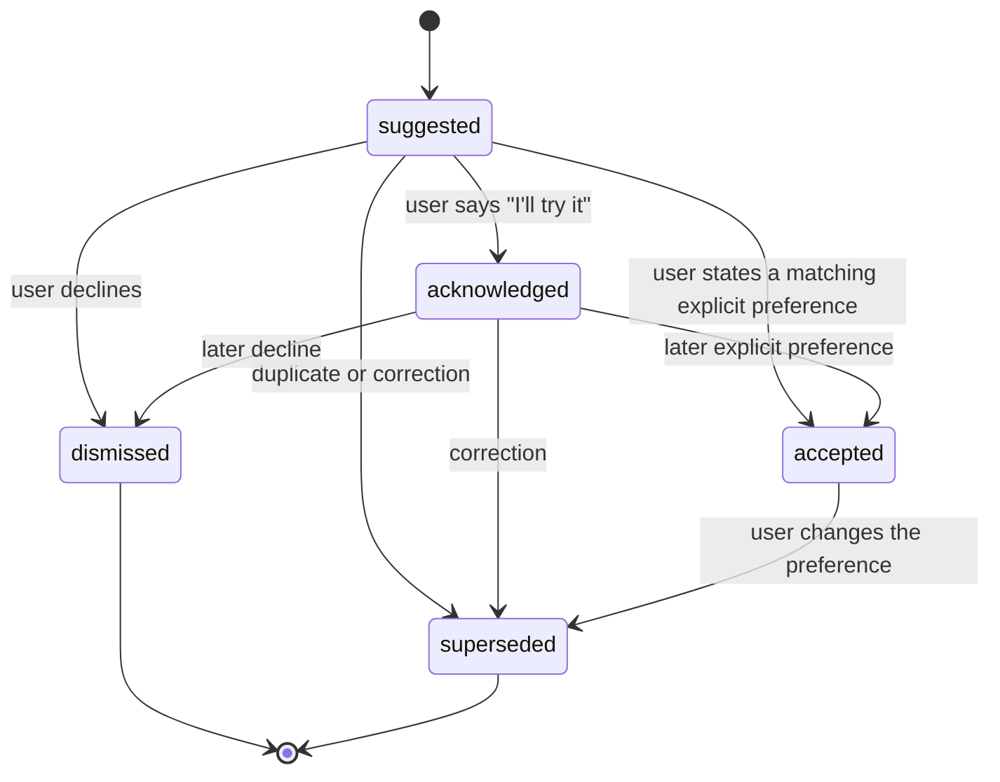

# M2 Advanced Personal Memory: Implementation Plan

**Status:** Proposed architecture and implementation plan. D12 acceptance criteria and D13 production-activation policy are finalized as of 2026-10-19. No M2 code, schema, configuration, or production data changes are made by this document.

**Phase:** Phase 3 planning, following `MEMORY_ARCHITECTURE.md` and `MEMORY_OPTIONS_EVALUATION.md`.

**Baseline:** committed Phase 1 source at `5bedac3`, current working tree source inspected read-only.

**Production snapshot:** verified 2026-10-19, fingerprint `8b84160c3d8b7d0f2a04ffab021cc4bba214d5285a884ad14b78c0eb6c788dc1`.

**Document convention:**

- **Existing** means behavior verified in the current source tree.
- **Proposed** means a design decision in this plan, not implemented behavior.
- **Gate** means a condition that must pass before the next milestone.
- **Amir test** means a real conversation check using only confirmed user statements and clearly labeled Aurora suggestions.

---

## 1. Executive Summary

PRIMORA already stores user-authored facts and preferences as current or superseded states, keeps assistant claims out of current truth, uses a slot registry for common personal facts, and retrieves memory through lexical, semantic, and structural channels (semantic retrieval is currently limited; see §11.7). It does **not** natively distinguish "Amir said he loves Strobe" from "Aurora suggested Titanium." That distinction is the core M2 requirement.

The proposed design keeps the existing `states` table as the single source of truth for user preferences. It adds:

1. A rebuildable `preference_metadata` table keyed by `state_id`, holding normalized domain/object/creator identity used for deduplication and retrieval.
2. A separate `recommendations` table for assistant-authored suggestions, with explicit status, provenance, and optional basis in a user preference.
3. A pure, deterministic preference identity module that extracts only what the user explicitly said. It never calls a model, never invents an artist, and never turns a suggestion into a preference.
4. Domain-aware retrieval and context assembly that puts confirmed user facts first and places suggestions in a separately labeled block that explicitly says they are not user preferences.
5. Additive, flag-gated migration and a 12-scenario acceptance matrix with hard safety gates.

**Recommendation:** proceed with native PRIMORA M2. Do not adopt Mem0, Graphiti, LangMem, or Letta for M2. Keep the Phase 2 Mem0 shadow experiment as a separately approved contingency, not part of this implementation.

**Expected user-visible result:** Amir can say he loves "Strobe." Aurora can later suggest "Titanium." In a new conversation, Aurora can recall that Amir loves Strobe, can attribute the Titanium idea to Aurora, and can honestly say that Amir has not confirmed liking Titanium.

---

## 2. Goals, Non-Goals, and Success Criteria

### 2.1 Goals

| ID | Goal | Measurable outcome |
|---|---|---|
| G1 | Preserve confirmed user preference truth | Only user-authored statements create or change current preferences. Assistant statements never do. |
| G2 | Improve attribution | Stored preferences retain object and creator separately when the user states them. "Strobe" by deadmau5 is not confused with another "Strobe." |
| G3 | Represent recommendations separately | A recommendation is stored as a suggestion, with source message, status, and optional basis in a user preference. It is never rendered as a user fact. |
| G4 | Improve retrieval | Explicit object, creator, domain, and intent queries retrieve relevant preferences; unrelated preferences and suggestions are suppressed. |
| G5 | Handle evolution and ambiguity | Corrections, polarity changes, and duplicates are deterministic. Hedged or pronoun-only statements never become confident truth. |
| G6 | Preserve production safety | Existing production rows and hashes remain unchanged. Tests use isolated databases. Rollback does not require destructive schema rewrites. |

### 2.2 Non-Goals

- No external memory service, model call, embedding call, or network dependency in M2.
- No general-purpose knowledge graph, entity-resolution catalog, or external music/movie database.
- No broad natural-language understanding beyond explicit existing patterns plus conservative identity parsing.
- No automatic web lookup to decide whether "Strobe" is a song or who created it.
- No UI redesign, memory editor, or user-facing confirmation workflow beyond existing pending-candidate semantics.
- No replacement of the existing state lifecycle, slot registry, candidate table, or hybrid retrieval.
- No backfill or rewriting of existing production states.
- No Mem0 integration in M2.
- No guarantee that semantically similar paraphrases outside the explicit rules are extracted.

### 2.3 Success Criteria

| ID | Criterion | Gate |
|---|---|---|
| SC1 | A user preference and an assistant recommendation are different records with different retrieval treatment. | Hard |
| SC2 | No recommendation can become a current user preference without a new explicit user statement. | Hard |
| SC3 | No assistant message can create a current state. | Hard |
| SC4 | Explicit object/creator statements keep object and creator distinct; missing metadata remains empty. | Hard |
| SC5 | Corrections and polarity changes create a successor and preserve history. | Hard |
| SC6 | Duplicate current preferences for the same canonical object are not injected. | Hard |
| SC7 | Relevant preferences are retrieved across sessions without dumping unrelated facts. | Hard |
| SC8 | Missing memory produces an honest "not stored" answer, not an inference. | Hard |
| SC9 | Existing memory tests and production isolation tests pass unchanged or with intentional schema-list updates. | Hard |
| SC10 | The implementation can be disabled by flags without dropping tables or rewriting states. | Hard |

### 2.4 User-Visible Acceptance Script

The following is the acceptance conversation used for manual verification. It is also represented in the automated matrix in Section 10.

1. Amir: "I love the song Strobe by deadmau5."
2. Aurora: acknowledges naturally; no special memory UI is required.
3. New session. Amir: "Recommend some music."
4. Aurora retrieves the confirmed Strobe preference and may offer suggestions. Any suggestion is labeled as Aurora's idea, not as Amir's preference.
5. Aurora: "You might like Titanium by David Guetta."
6. Amir: "What do I like?"
7. Aurora: "You've told me you love Strobe by deadmau5. I suggested Titanium, but you haven't confirmed that you like it."
8. Amir: "I'll try Titanium."
9. Aurora treats that as acknowledgement, not preference.
10. Amir: "Actually, I love Titanium by David Guetta."
11. Aurora records a confirmed preference, links it to the recommendation, and no longer presents Titanium as an unconfirmed suggestion.

---

## 3. Baseline: Existing Behavior and Evidence

### 3.1 Current Data Flow



**Existing interpretation:** user preferences are stored as states; assistant claims can only be recorded as unresolved, never current; there is no native recommendation record and no canonical preference identity.

### 3.2 Verified Source Map

| Area | Existing behavior | Evidence |
|---|---|---|
| State schema | `states` holds concept, value, source IDs, status, authority, type, confidence, and temporal fields. | `PRIMORA/prime/context/store.py:89-106` |
| Current-state guard | A non-user authority state cannot be current. | `PRIMORA/prime/context/store.py:766-770` |
| Successor writes | Corrections and supersession use `create_state_successor`. | `PRIMORA/prime/context/store.py:873` |
| State reads | Current and historical states are fetched by scope/concept/status. | `PRIMORA/prime/context/store.py:1012` |
| Candidate schema | Pending candidates are separate rows with proposed concept/value and status. | `PRIMORA/prime/context/store.py:111-129` |
| State model | `StateRecord` contains the existing truth fields. | `PRIMORA/prime/context/models.py:79` |
| Candidate model | `CandidateRecord` contains pending proposal fields. | `PRIMORA/prime/context/models.py:110` |
| User extraction | Slot phrasings run first, then legacy and extended fallbacks; correction prefixes unwrap. | `PRIMORA/prime/context/state.py:569-687` |
| Slot registry | Personal facts are config-driven; likes are keyed and global. | `PRIMORA/prime/context/slots.py:252`; `PRIMORA/prime/context/slots.json` |
| Preference confirmation | Resolved candidates use the shared `_apply_confirmed` path and existing successor logic. | `PRIMORA/prime/context/state.py:916-996` |
| Assistant claims | Assistant establishments are recorded as unresolved and never current. | `PRIMORA/prime/context/state.py:1329-1379` |
| State routing | The manager sends user text to extraction and assistant text only to conflict checking. | `PRIMORA/prime/context/manager.py:1441-1466` |
| Current-state admission | Only user-authored, valid current states are eligible; global states have special admission rules. | `PRIMORA/prime/context/manager.py:2506-2570` |
| Hybrid retrieval | Four channels are fused. The semantic index is implemented, but live sync/search is session-scoped; production currently has zero eligible session-scoped states and nine eligible global states. | `PRIMORA/prime/context/hybrid.py:41`, `:95`, `:428`; `manager.py:2051`; §11.7 |
| Isolation | The production fingerprint covers a fixed memory-table tuple. | `PRIMORA/prime/context/isolation.py:43-111` |
| Assistant barrier test | Existing tests prove assistant claims never become current. | `TESTS/prime/test_memory_formation.py:188` |

### 3.3 Current Strengths

- **Truth discipline:** `create_state` rejects assistant-authored current states at the storage boundary. This is a strong invariant and must remain.
- **Provenance:** states carry source IDs, authority, status, and supersession history.
- **Correction support:** correction prefixes and successor writes already exist.
- **Pending candidates:** hedged statements can wait instead of becoming truth.
- **Personal-fact routing:** the slot registry already handles names, locations, preferences, rules, and notes.
- **Retrieval safety:** current-state admission is user-only; cross-session and global rules are explicit.
- **Test isolation:** the suite redirects default database paths to temporary databases and includes a production-write regression test.
- **No external dependency:** extraction is deterministic and local.

### 3.4 Current Gaps

| Gap | Current consequence | M2 response |
|---|---|---|
| No recommendation record | Aurora cannot reliably remember what it suggested or whether the user acknowledged it. | Separate `recommendations` table and lifecycle. |
| No canonical preference identity | "Strobe", "Strobe by deadmau5", "my favorite song is Strobe", and "I love Strobe" can become separate concepts. | Normalized preference metadata and duplicate detection. |
| No explicit domain metadata | A music preference may not be retrieved for "recommend some music" unless the query names the object. | Conservative domain metadata; direct-object retrieval remains primary. |
| Assistant claim parser is narrow | It is not a general recommendation extractor and does not reliably parse second-person preference claims. | Recommendation extractor with explicit patterns; unchanged assistant-current guard. |
| No suggestion grounding block | The model has no explicit distinction between confirmed facts and ideas Aurora raised. | Separate labeled suggestion block and prompt rule. |
| No recommendation lifecycle | No suggested/acknowledged/accepted/dismissed states. | Explicit status model and user-authored transitions. |
| Broad fallback notes | Unmatched "I..." statements can become capped global notes. | Preserve existing behavior; M2 does not widen fallback capture. |
| Possible cross-schema duplicates | Different concepts can represent the same preference. | Read-time canonical deduplication; no destructive rewrite. |
| Semantic retrieval limited | Live sync/search is session-scoped and does not include global states; production's eligible states are global. The fixed paraphrase baseline also misses the current 0.45 semantic threshold. | Do not depend on semantic retrieval for M2. If semantic retrieval is claimed, scope/calibration repair and re-evaluation are required per §11.7. |

### 3.5 Production Evidence

The current production database is small and should be treated as read-only during this phase.

| Table | Rows | SHA-256 |
|---|---:|---|
| messages | 268 | `43a0bed7...` |
| messages_fts | 268 | `a024df34...` |
| sessions | 1 | `2fc54489...` |
| digests | 7 | `9acb729a...` |
| states | 14 | `49b46275...` |
| candidates | 6 | `b87d8742...` |
| entities | 0 | `e3b0c442...` |
| entity_aliases | 0 | `e3b0c442...` |
| relationships | 0 | `e3b0c442...` |
| retrieval_vectors | 0 | `e3b0c442...` |
| retrieval_index_meta | 5 | `5c6c14d4...` |

State composition: 7 current, 2 superseded, 5 unresolved; 5 default-scope, 9 global; 5 with empty type, 6 FACT, 3 PREFERENCE. There are no semantic vectors, no entities, and no relationships. The database is therefore a good compatibility baseline: migration must preserve these rows exactly while allowing the new tables to start empty.

**Fingerprint caution:** the content-based fingerprint is expected to change when new tables are added. The correct migration check is that **all pre-existing table row hashes remain unchanged**, new tables are empty, and no production write occurs during tests. Never reset the production database to restore a fingerprint.

---

## 4. Proposed Architecture

### 4.1 Design Principles

1. **User truth remains singular.** `states` is the only source of truth for user preferences. Preference metadata may be rebuilt from states and never overrides them.
2. **Suggestions are a different kind of object.** Recommendations have their own table, their own status, and their own rendering block. They are not states.
3. **No inference without evidence.** An object, creator, or domain is stored only when the user or assistant explicitly supplied it in a parseable form. Unknown values stay empty.
4. **Deterministic extraction.** M2 adds regex and normalization rules, not a model. A failure returns no record or a pending candidate; it never invents.
5. **Additive migration.** New tables only. Existing states, candidates, messages, and digests are not rewritten.
6. **Conservative rollout.** Every new write and read path is independently flag-gated and off by default.
7. **Safety over coverage.** A missed preference is acceptable. A recommendation stated as a user preference is not.

### 4.2 Proposed Data Flow



**Read-path rule:** confirmed user facts and suggestions are assembled into separate blocks. The suggestion block is never merged into the facts block.

### 4.3 Components

| Component | Status | Responsibility |
|---|---|---|
| `states` | Existing, unchanged | User truth and history. |
| `candidates` | Existing, unchanged | Pending or ambiguous proposals. |
| `preference_metadata` | Proposed new table | Rebuildable identity index for preference states. |
| `recommendations` | Proposed new table | Assistant suggestions and lifecycle. |
| `preferences.py` | Proposed new module | Pure normalization, identity, dedupe, admission helpers. |
| `recommendations.py` | Proposed new module | Pure deterministic recommendation extraction and matching. |
| `state.py` | Existing, extended | Attach preference identity, preserve correction/pending behavior. |
| `manager.py` | Existing, extended | Route assistant recommendations; assemble labeled blocks. |
| `slots.py` / `slots.json` | Existing, unchanged | Existing slot routing and facts heading. |
| `store.py` | Existing, extended | New tables and CRUD methods. |
| `models.py` | Existing, extended | Dataclasses for metadata and recommendations. |
| `isolation.py` | Existing, extended | Include new tables in the memory-table boundary. |
| `hybrid.py` | Existing, unchanged | Existing retrieval remains; M2 admission runs before assembly. |

### 4.4 Write Path

**User message**

1. Existing snapshot and message persistence occur unchanged.
2. Existing `extract_candidates` runs unchanged.
3. If a candidate is a preference, `preferences.identity_from_text` derives a canonical identity from the original text and candidate slot/value.
4. The existing confirmation path decides whether the candidate is current, pending, or rejected.
5. If current, the state is written through the existing `create_state` / `create_state_successor` path.
6. In the same logical operation, a `preference_metadata` row is inserted or left absent for read-time fallback. Metadata failure never changes truth; it degrades to fallback identity.
7. If the user statement accepts a recommendation, the recommendation status is updated only after the user preference state exists.

**Assistant message**

1. Existing assistant conflict checking runs unchanged and still cannot create current states.
2. `recommendations.extract` looks for explicit suggestion patterns.
3. A valid suggestion is stored with `authority="assistant"`, source message ID, target, optional creator/domain, and optional basis state IDs.
4. If the assistant message merely claims "You love X" without a recommendation cue, it is not stored as a recommendation and does not become a preference. Existing unresolved-claim handling may record it as an unresolved assistant claim.
5. Duplicate suggestions are merged or superseded according to the lifecycle rules.

### 4.5 Read Path

1. Existing hybrid retrieval produces transcript/entity candidates.
2. M2 loads current user states and their preference metadata.
3. Preference admission selects canonical, user-authored, relevant preferences within the cap.
4. Recommendation admission selects relevant suggestions within a separate cap.
5. Assembly renders confirmed facts under the existing facts heading and suggestions under a new suggestion heading.
6. Historical states or dismissed/superseded recommendations are included only for explicit history queries.
7. Budget pressure drops suggestions first, then unrelated/low-relevance material. Named confirmed facts are never displaced by suggestions.

### 4.6 Failure Behavior

| Failure | Required behavior |
|---|---|
| Preference identity parser fails | Keep the existing state behavior; mark metadata absent; use legacy read-time fallback; never invent fields. |
| Identity is ambiguous | Do not create confident current preference; use pending candidate or no record. |
| Metadata write fails | Log a diagnostic; state remains truth; retrieval uses fallback identity. |
| Recommendation parse is ambiguous | Store nothing; do not guess a target or basis. |
| Recommendation table unavailable | Disable recommendation reads; user facts still work. |
| Duplicate legacy states exist | Read-side newest-per-canonical-key wins; older duplicates are skipped with a diagnostic. |
| Source message missing | Keep stored records; provenance remains IDs; do not reconstruct message text. |
| Model ignores suggestion label | Acceptance test fails; do not add an LLM verifier in M2. Tighten prompt or disable recommendation injection. |

---

## 5. Record Model

### 5.1 Preference Record

A preference is a **logical view** composed of an existing `states` row plus optional `preference_metadata`:

```text
PreferenceRecord
  state_id
  session_id
  scope
  concept
  value
  source_ids
  status
  authority
  memory_type
  confidence
  observed_at
  valid_from
  valid_until
  superseded_at
  supersedes_id
  + preference_metadata
      domain
      object_kind
      object_key
      creator_key
      polarity
      canonical_key
      slot_key
      identity_status
      extractor_version
```

The state is authoritative for value, status, authority, and temporal truth. Metadata supplies identity fields that states do not carry. If the metadata row is missing, malformed, or stale, `preferences.identity_from_state` reconstructs the best partial identity from the state. Explicit cues that existed only in the original message may not be recoverable from the normalized state, so reconstruction can be partial rather than byte-identical. If metadata contradicts explicit state text, do not use the contradictory field; fall back to derived identity.

| Field | Type | Required | Semantics |
|---|---|---|---|
| `state_id` | integer | Yes | Existing state primary key. |
| `session_id` | text | Yes | Existing state origin. |
| `scope` | text | Yes | `session` or `global`; existing semantics. |
| `concept` | text | Yes | Existing human-readable concept. Kept for compatibility. |
| `value` | text | Yes | Existing natural-language value. Rendered as a fact. |
| `source_ids` | JSON text | Yes | Existing message provenance. |
| `status` | text | Yes | Existing `current`, `superseded`, `unresolved`; only current is preference truth. |
| `authority` | text | Yes | Must be `user` for current preference truth. |
| `memory_type` | text | Yes | Must be `PREFERENCE` for preference records. |
| `confidence` | real or null | No | Existing confidence, if supplied. |
| temporal fields | real or null | No | Existing observed/valid/superseded timestamps. |
| `domain` | text | Yes in metadata, may be empty | Closed vocabulary such as `music`; empty means not explicitly known. |
| `object_kind` | text | Yes in metadata, may be empty | Closed vocabulary such as `song`, `album`, `artist`; empty means unknown. |
| `object_key` | text | Yes | Normalized object surface key; empty only for invalid candidates, which are not stored. |
| `creator_key` | text | Yes, may be empty | Normalized creator key only if explicitly stated. |
| `polarity` | text | Yes | `positive` or `negative`; no confident preference without a clear polarity. |
| `canonical_key` | text | Yes | Versioned identity string. |
| `slot_key` | text | Yes, may be empty | Stable slot identity for single-valued slots, e.g. `favorite_color`. |
| `identity_status` | text | Yes | `canonical` (explicit domain/kind/object) or `partial` (object known, some dimensions unknown). |
| `extractor_version` | integer | Yes | Starts at `1`; allows future re-derivation. |
| `created_at` | real | Yes | Metadata insertion time. |

**Metadata table is not a second truth store.** It does not store `value`, `status`, `authority`, or `scope`. Those remain only on the state.

### 5.2 Recommendation Record

| Field | Type | Required | Semantics |
|---|---|---|---|
| `id` | integer | Yes | Primary key. |
| `session_id` | text | Yes | Session where Aurora made the suggestion. |
| `scope` | text | Yes | `global` when linked to a global basis preference; otherwise `session`. |
| `source_message_id` | integer | Yes | The assistant message that contained the suggestion. |
| `authority` | text | Yes | Always `assistant`; validated at write time. |
| `target_label` | text | Yes | Exact bounded surface target, e.g. `Titanium`. |
| `target_key` | text | Yes | Normalized target key. |
| `creator_label` | text | No | Exact explicit creator surface, e.g. `David Guetta`; empty if not stated. |
| `creator_key` | text | No | Normalized creator key; empty if not stated. |
| `domain` | text | No | Explicit domain from recommendation wording or linked basis; may be empty. |
| `canonical_key` | text | Yes | Versioned recommendation identity, prefixed `m2r1\|`. |
| `basis_state_ids` | JSON text | Yes | State IDs explicitly cited as the reason for the suggestion; `[]` if none. |
| `status` | text | Yes | `suggested`, `acknowledged`, `accepted`, `dismissed`, `superseded`. |
| `confidence` | real | Yes | Deterministic extraction confidence in `[0, 1]`; not a truth probability claim. |
| `accepted_preference_id` | integer or null | No | State ID of the user preference that confirmed the suggestion. |
| `supersedes_id` | integer or null | No | Earlier recommendation replaced by this one. |
| `status_source_message_id` | integer or null | No | User message that changed the status. |
| `status_reason` | text | No | Short machine-readable reason such as `already_preferred`, `explicit_acceptance`. |
| `created_at` | real | Yes | Insertion time. |
| `updated_at` | real | Yes | Last lifecycle update. |
| `observed_at` | real or null | No | Source message observation time. |
| `valid_from` | real or null | No | Optional validity start. |
| `valid_until` | real or null | No | Optional validity end. |
| `superseded_at` | real or null | No | Supersession time. |
| `extractor_version` | integer | Yes | Starts at `1`. |

Recommendations do not have `concept`, `value`, or `status="current"`. They are never admitted as facts.

### 5.3 Canonical Identity

**Preference key format:**

```text
m2p1|<domain>|<object_kind>|<object_key>|<creator_key>|<polarity>
```

Examples:

| Statement | Canonical key | Notes |
|---|---|---|
| "I love the song Strobe by deadmau5." | `m2p1\|music\|song\|strobe\|deadmau5\|positive` | Full explicit identity. |
| "I love Strobe." | `m2p1\|\|\|strobe\|\|positive` | Domain, kind, and creator empty. Nothing invented. |
| "My favorite artist is deadmau5." | `m2p1\|music\|artist\|deadmau5\|\|positive` | The object is the artist; creator is empty. |
| "I don't like Strobe anymore." | `m2p1\|\|\|strobe\|\|negative` | Same object key, opposite polarity. |

**Recommendation key format:**

```text
m2r1|<domain>|<target_key>|<creator_key>
```

Recommendation keys are not used for user preference deduplication. They exist for duplicate suggestion detection and history display.

Normalization rules:

- Lowercase, trim, collapse whitespace, strip leading articles where safe.
- Normalize a small set of punctuation and possessives only when unambiguous.
- Do not perform fuzzy matching, stemming beyond plural normalization, or external alias resolution in M2.
- Empty dimensions remain empty; do not substitute `unknown` into the canonical key.
- `slot_key` is separate: for single-valued slots it is derived from the slot identity, not from the object.
- Scope is not part of the canonical key; deduplication is per scope, with existing global/session rules.

### 5.4 Status Machines

**Preference lifecycle**



- `pending` is an existing candidate, not a preference record.
- `current` requires `authority="user"` and a clear positive or negative polarity.
- `superseded` retains history.
- `unresolved` is used for assistant claims and unresolved user claims; it is never preference truth.

**Recommendation lifecycle**



- Only explicit user messages can move a recommendation to `accepted`, `acknowledged`, or `dismissed`.
- "I'll try it" is `acknowledged`; it is not a preference.
- "I love <explicit target>" is `accepted` only when it matches a recommendation and the resulting preference is explicit. Pronoun-only "I love it" does not create a preference; Aurora should ask which item the user means.
- An accepted recommendation is not deleted; its linked preference becomes the fact.
- A recommendation that already matches a current preference is `superseded` with reason `already_preferred` and is not injected.

### 5.5 Worked Examples

| Turn | Record effect | Retrieval effect |
|---|---|---|
| User: "I love the song Strobe by deadmau5." | Current state `PREFERENCE`, metadata domain `music`, kind `song`, object `strobe`, creator `deadmau5`, positive. | Eligible for music queries, direct "Strobe" queries, and broad self-queries within cap. |
| Assistant: "You might like Titanium by David Guetta because you love Strobe." | Recommendation `suggested`, target `Titanium`, creator `David Guetta`, basis = Strobe state, scope = Strobe's scope. | Eligible as a labeled suggestion, never as a fact. |
| User: "I'll try Titanium." | Recommendation `acknowledged`; no preference state. | Rendered as "you said you would try it; not confirmed." |
| User: "I love Titanium by David Guetta." | New current preference; recommendation `accepted` and linked; no duplicate suggestion line. | Titanium appears in the facts block. |
| User: "I don't like Strobe anymore." | New negative current state; prior positive superseded. | Current negative fact; historical positive only on explicit history query. |
| Assistant: "You love Titanium." | No current state; no recommendation unless a recommendation cue is present; unresolved claim is allowed. | Never injected as a user preference. |

### 5.6 Proposed DDL Sketch

This is a design sketch, not a migration to execute in this phase.

```sql
CREATE TABLE IF NOT EXISTS preference_metadata (
    state_id INTEGER PRIMARY KEY,
    domain TEXT NOT NULL DEFAULT '',
    object_kind TEXT NOT NULL DEFAULT '',
    object_key TEXT NOT NULL DEFAULT '',
    creator_key TEXT NOT NULL DEFAULT '',
    polarity TEXT NOT NULL DEFAULT 'positive',
    canonical_key TEXT NOT NULL,
    slot_key TEXT NOT NULL DEFAULT '',
    identity_status TEXT NOT NULL DEFAULT 'partial',
    extractor_version INTEGER NOT NULL DEFAULT 1,
    created_at REAL NOT NULL
);

CREATE INDEX IF NOT EXISTS idx_preference_metadata_canonical
    ON preference_metadata(canonical_key);
CREATE INDEX IF NOT EXISTS idx_preference_metadata_slot
    ON preference_metadata(slot_key);

CREATE TABLE IF NOT EXISTS recommendations (
    id INTEGER PRIMARY KEY AUTOINCREMENT,
    session_id TEXT NOT NULL,
    scope TEXT NOT NULL,
    source_message_id INTEGER NOT NULL,
    authority TEXT NOT NULL DEFAULT 'assistant',
    target_label TEXT NOT NULL,
    target_key TEXT NOT NULL,
    creator_label TEXT NOT NULL DEFAULT '',
    creator_key TEXT NOT NULL DEFAULT '',
    domain TEXT NOT NULL DEFAULT '',
    canonical_key TEXT NOT NULL,
    basis_state_ids TEXT NOT NULL DEFAULT '[]',
    status TEXT NOT NULL DEFAULT 'suggested',
    confidence REAL NOT NULL DEFAULT 0.5,
    accepted_preference_id INTEGER,
    supersedes_id INTEGER,
    status_source_message_id INTEGER,
    status_reason TEXT NOT NULL DEFAULT '',
    created_at REAL NOT NULL,
    updated_at REAL NOT NULL,
    observed_at REAL,
    valid_from REAL,
    valid_until REAL,
    superseded_at REAL,
    extractor_version INTEGER NOT NULL DEFAULT 1
);

CREATE INDEX IF NOT EXISTS idx_recommendations_scope_status
    ON recommendations(scope, status);
CREATE INDEX IF NOT EXISTS idx_recommendations_canonical
    ON recommendations(canonical_key);
CREATE INDEX IF NOT EXISTS idx_recommendations_source
    ON recommendations(source_message_id);
```

Deliberate choices:

- No foreign keys, matching the existing schema style and avoiding migration coupling.
- Application code validates that `accepted_preference_id` points to a user preference and that `basis_state_ids` exist.
- `preference_metadata` is a best-effort index, not truth. Deleting it is recoverable only to a partial identity; the state remains authoritative.
- `recommendations` may be cleared independently of user memory, but production rollback should simply stop reading it.
- No `ALTER TABLE states` is required.

### 5.7 Alternatives Considered

| Decision | Option A | Option B | Choice and reason |
|---|---|---|---|
| Preference persistence | Add preference columns to `states`. | Add a separate, rebuildable `preference_metadata` table keyed by `state_id`. | **B.** Avoids widening the truth table, avoids changing every state read/write, and keeps migration additive. Tradeoff: one extra local lookup. |
| Recommendation persistence | Store suggestions as assistant-authority states. | Use a separate `recommendations` table with its own lifecycle. | **B.** A suggestion is not a user fact, has different statuses, and needs a separate rendering block. Reusing states would invite truth confusion. |
| Extraction | Use an LLM or embedding classifier. | Use deterministic explicit patterns and normalization. | **B.** No network, no telemetry, reproducible decisions, and no invented metadata. Tradeoff: narrower paraphrase coverage. |
| Recommendation scope | Make all suggestions global. | Follow the basis preference; otherwise session scope. | **B.** Prevents unrelated suggestions from leaking across sessions while preserving useful global preferences. |
| Legacy compatibility | Backfill and rewrite existing states. | Read-time fallback and no backfill. | **B.** Existing rows and hashes remain untouched; duplicate suppression happens at read time. |
| Retrieval | Build or depend on semantic vectors. | Use exact object, creator, slot, and conservative domain admission. | **B.** Production's eligible states are global and outside the live session-scoped semantic path; the current paraphrase baseline also misses the semantic threshold. M2 does not need an index. Tradeoff: lower recall for unstated domains. |
| Memory platform | Adopt Mem0. | Extend native PRIMORA records. | **B.** Keeps the existing assistant-current barrier and provenance model; Mem0 is a contingency only. |

---

## 6. Preference Extraction and Update Design

### 6.1 Extraction Pipeline

The existing extraction order remains: slot phrasings, legacy, extended, notes fallback. M2 adds identity enrichment and preference-specific deduplication without replacing the current parsers.

1. Role gate: only `role == "user"` and non-empty text.
2. Scope marker handling: existing session/global routing.
3. Correction prefix unwrap: existing behavior.
4. Slot routing: existing `likes`, learned favorite, and related slots.
5. Legacy/extended fallback: existing behavior.
6. Identity enrichment: if the candidate is a preference, parse the original user text for explicit domain, object, creator, and polarity.
7. Candidate classification: canonical, partial, ambiguous, or not a preference.
8. Apply: existing confirmation, pending, and supersession path.
9. Metadata write: insert identity for the resulting current state; failure degrades to fallback.

### 6.2 Preference Identity Module

Proposed `PRIMORA/prime/context/preferences.py` is pure and has no store, model, network, or clock dependency except an optional explicit timestamp argument.

```text
PreferenceIdentity
  domain: str
  object_kind: str
  object_key: str
  creator_key: str
  polarity: str
  canonical_key: str
  slot_key: str
  identity_status: str
  extractor_version: int

identity_from_text(text, slot_key="", slot_value="") -> PreferenceIdentity | None
identity_from_state(state) -> PreferenceIdentity | None
compatible_object(a, b) -> bool
preference_terms(identity) -> set[str]
domain_cues(query) -> set[str]
is_same_preference(a, b) -> bool
```

All helpers return empty fields rather than guessing. A parse that cannot identify an object returns `None`.

### 6.3 Domain and Object Vocabulary

M2 uses a small closed vocabulary. It is not an external catalog.

**Domains:** `music`, `film_tv`, `books`, `food_drink`, `travel`, `activity`.

**Object kinds:** `song`, `album`, `artist`, `genre`, `film`, `series`, `book`, `author`, `dish`, `drink`, `place`, `activity`.

**Creator roles:** artist, director, author, and similar explicit "by" relationships. M2 stores the creator key but does not need a separate creator-role field in v1; the domain and object kind supply enough context for rendering.

**Cue examples:**

| Cue in user text | Domain | Object kind |
|---|---|---|
| "the song", "track", "single" | `music` | `song` |
| "album", "record", "LP" | `music` | `album` |
| "artist", "band", "musician" | `music` | `artist` |
| "movie", "film" | `film_tv` | `film` |
| "show", "series", "episode" | `film_tv` | `series` |
| "book", "novel" | `books` | `book` |
| "author", "writer" | `books` | `author` |
| "food", "dish", "meal" | `food_drink` | `dish` |
| "drink", "coffee", "tea" | `food_drink` | `drink` |
| "city", "country", "place" | `travel` | `place` |
| "hobby", "activity", "game", "sport" | `activity` | `activity` |

Cues are accepted only when they are explicit and close to the object. A generic query word such as "music" does not retroactively label an earlier "I love Strobe" statement. That would be inference. A later explicit statement can enrich identity through a successor, but M2 does not silently rewrite history.

### 6.4 Explicit Preference Patterns

M2 relies on the existing explicit patterns, including:

- "I love/like/adore X."
- "I hate/dislike X."
- "I don't like X anymore."
- "My favorite <noun> is X."
- Correction forms: "Actually, ...", "No, ...", "That's wrong, ...".

M2 does not add broad paraphrase extraction such as "X is my jam" or "I'm obsessed with X" in the first implementation. Those can be added later only with tests proving they do not misclassify recommendations.

**Pronoun and vague-object rejection:** objects such as `it`, `that`, `this`, `one`, `them`, `something`, and `stuff` are not stored as preferences without a deterministic antecedent. Existing extraction may produce a candidate; M2 filters it before preference metadata and truth. A pronoun-only statement remains conversational context, not memory truth.

**Hedge handling:** existing hedged statements already become pending candidates. M2 preserves that. A hedged preference never receives current metadata until explicit confirmation.

### 6.5 Creator Parsing

Creator is captured only from an explicit construction:

- "Strobe by deadmau5"
- "the song Strobe by deadmau5"
- "Titanium by David Guetta"
- "the album Random Access Memories by Daft Punk"

Rules:

- The creator span ends at a clause boundary, punctuation, or a limited list of stop phrases.
- Do not treat every capitalized word as a creator.
- Do not parse "by" inside a title unless the surrounding structure is explicit.
- If the creator is ambiguous or contains a pronoun, leave it empty.
- Do not copy a creator from a recommendation into a user preference unless the user explicitly stated it.

### 6.6 Deduplication and Supersession

**Matching order:**

1. Exact `canonical_key` within the applicable scope and global fallback.
2. Exact `slot_key` for a single-valued slot.
3. Existing concept match as a legacy fallback.
4. If multiple conflicting matches remain, do not guess; use pending/unresolved.

**Outcomes:**

| Situation | Action |
|---|---|
| Same canonical key, same polarity, same value | No-op; diagnostic only. |
| Same canonical key, opposite polarity | Create successor with new polarity; supersede predecessor. |
| Same single-valued slot, different object | Create successor; supersede predecessor. |
| Same object, creator previously empty, now explicitly supplied | Create successor with enriched identity if exactly one title-only current exists and no conflicting creator. Do not mutate the old row. |
| Same title, different explicit creators | Distinct preferences if both are explicit; do not merge. |
| Same title, one creator empty | Do not auto-merge during ordinary extraction; keep separate and use read-side ambiguity handling. |
| Multiple possible predecessors | Do not choose; hold pending or leave unresolved. |
| Exact duplicate from legacy extraction | Skip injection of the older duplicate; keep the newest current record. |

**Cross-schema duplicate:** existing concepts such as `likes for strobe` and `favorite song` may both represent the same canonical object. M2 uses canonical metadata to suppress duplicate injection, while preserving the underlying states. No destructive merge is required.

**Read-side deduplication:** current states are grouped by `(scope, canonical_key)` and by `(scope, slot_key)` when present. The newest state wins; older duplicates produce `state_preference_duplicate` diagnostics. This protects existing data without rewriting it.

**Read-side title-only rule:** if a title-only current preference has the same `object_key` as exactly one creator-bearing current preference in the same scope, and there is no conflicting creator, the creator-bearing record is preferred and the title-only duplicate is suppressed. If two or more explicit creators match the same title, the title-only record is ambiguous and is suppressed for that query; explicit records remain distinct. Source records are never merged or deleted.

### 6.7 Pending Confirmation

The existing candidate table is not extended in M2. At confirmation:

1. Re-fetch the candidate's source user message.
2. Re-run identity derivation against the original text and slot.
3. If a unique identity is available, apply it.
4. If the source message is missing or identity is ambiguous, keep the candidate pending/unresolved and write no preference.
5. Never confirm a preference from the candidate's normalized value alone when the original cue is needed.

This avoids a schema change while preserving the evidence needed for domain and creator parsing.

### 6.8 Recommendation Acceptance

A recommendation becomes accepted only when a new explicit user preference is compatible:

- Object keys match.
- Creator keys match when both are present.
- If one creator is empty, acceptance is allowed only when the object match is unique and there is no conflicting creator.
- Domain matches when both are present.
- Polarity is positive.

Compatibility is used for lifecycle linking only. It does not copy missing creator/domain fields into the user preference. The user preference keeps exactly what the user said.

### 6.9 Assistant Messages

Existing assistant handling remains:

- `check_assistant_conflict` may record an unresolved claim for audit.
- No assistant message may create a current state.
- Recommendation extraction is additive and separate.
- "You love Titanium" is not a recommendation. It is at most an unresolved assistant claim and must never be rendered as a user fact.
- "I recommend Titanium" is a recommendation, not a fact.
- "You might like Titanium because you love Strobe" is a recommendation with a basis only if the basis resolves uniquely to a current user preference.

---

## 7. Recommendation Extraction and Lifecycle

### 7.1 Explicit Patterns

M2 recognizes a bounded set of assistant suggestion forms:

- "I recommend X."
- "I'd recommend X."
- "I would recommend X."
- "You might like X."
- "You may like X."
- "You could like X."
- "You should try X."
- "You'd probably like X."
- "I think you'd like X."
- "Try X."
- "Consider X."
- "Consider listening to X."
- "Consider watching X."
- "Consider reading X."
- "Have you considered X?"

The extractor must:

- Require an explicit target span.
- Reject pronouns and vague targets without a unique antecedent.
- Reject a target that is only a generic category ("some music", "a movie").
- Bound the target to a short span; do not swallow the rest of the sentence.
- Extract an explicit creator after "by" only when structurally clear.
- Extract a basis only from an explicit clause such as "because you love X" and only when X resolves to a unique current user preference.

### 7.2 Not Recommendations

The following are not stored as recommendations:

- "You love Titanium." (claim)
- "Titanium is a song by David Guetta." (factual statement)
- "You said you liked Titanium." (user-report claim)
- "Do you like Titanium?" (question)
- "I listened to Titanium." (assistant experience)
- "Titanium is great." (opinion without a recommendation cue)
- "I recommend it." (pronoun without a unique antecedent)

### 7.3 Scope

- If a recommendation has a uniquely resolved basis preference, scope follows that preference: global basis gives a global recommendation; session basis gives a session recommendation.
- If there is no basis, the recommendation is session-scoped.
- A session-scoped recommendation may be shown in a new session only when the user explicitly asks for suggestion history and the scope rules permit it. Default retrieval does not promote it.
- No recommendation becomes global merely because its target is famous.

### 7.4 Duplicate Suggestions

- Same canonical recommendation key in the same scope and still `suggested` or `acknowledged`: no-op or update confidence; do not create a second visible suggestion.
- Same target, different explicit creator: distinct suggestions.
- Same target, one creator empty: do not merge if a conflicting creator exists.
- A recommendation that already matches a current preference is `superseded` with reason `already_preferred`.

### 7.5 Lifecycle Resolution

- "I'll try it" / "I'll give it a try": resolve only the most recent unique `suggested` recommendation in the current session; set `acknowledged`.
- "No thanks" / "I don't want that": resolve the most recent unique `suggested` recommendation; set `dismissed`.
- "I love X" / "I like X": create a user preference, then mark a compatible recommendation `accepted`.
- "I don't like X": create a negative preference; mark a compatible recommendation `dismissed` or `superseded` with reason `negative_preference`.
- Ambiguous reference: no status change.

### 7.6 Recommendation Grounding Rules

- A recommendation is always attributed to Aurora.
- A recommendation is never a fact about the user.
- An acknowledged recommendation is not a preference.
- An accepted recommendation is represented by the linked user preference in the facts block; the suggestion block omits it.
- Dismissed and superseded recommendations are not injected by default.
- Historical recommendation queries may show dismissed/superseded items with explicit status.

---

## 8. Retrieval, Context Assembly, and Grounding

### 8.1 Query Intent

M2 uses deterministic query signals, not an LLM classifier.

| Intent | Signals | Behavior |
|---|---|---|
| Direct object | Query names stored object/creator/slot | High-priority exact preference. |
| Domain | Query names a domain cue such as music, film, book, food | Admit relevant preferences in that domain, capped. |
| Broad self-query | "What do you know about me?", "What do I like?" | Existing facts behavior; preference cap applies. |
| Recommendation request | "Recommend", "suggest", "what should I listen to" | Include relevant preferences and labeled suggestions. |
| History | "used to", "previously", "what did you suggest" | Include superseded preferences or recommendation history explicitly. |
| Unrelated | Query has no object, creator, slot, or domain overlap | Do not inject preference or suggestion by default. |

### 8.2 Preference Admission

A preference is eligible only if all are true:

1. State authority is `user`.
2. State status is `current`.
3. State is valid at evaluation time.
4. A derived or stored identity exists.
5. The query has direct, slot, domain, or broad-self relevance.
6. The preference passes canonical and slot deduplication.

**Ranking:**

1. Direct object/creator match.
2. Direct slot match.
3. Explicit domain match.
4. Broad self-query recency.
5. No match (not admitted).

**Caps:**

- Maximum 3 preference records per response.
- One current record per canonical key and scope.
- One current record per single-valued slot.
- Existing non-preference facts keep their existing admission rules.
- Named confirmed facts are never displaced by suggestions.

**Domain limitation:** if the user said only "I love Strobe" and never supplied a music cue, M2 stores a partial identity with empty domain. It will be retrieved by direct "Strobe" queries but not by a generic "music" query. This is intentional: the alternative is inventing metadata. A later explicit statement can enrich it through a successor.

### 8.3 Recommendation Admission

A recommendation is eligible only if all are true:

1. Authority is `assistant`.
2. Status is `suggested` or `acknowledged` for normal retrieval.
3. Scope is visible in the current session, or it is linked to a visible global basis preference.
4. The query explicitly requests suggestions, names the target, or has a relevant domain/basis link.
5. No current user preference is compatible with the target.
6. The recommendation fits the cap and reserve.

**Caps:**

- Maximum 2 recommendations per response.
- At most one recommendation per canonical recommendation key.
- Suggestions are dropped before confirmed facts under budget pressure.
- Accepted, dismissed, and superseded recommendations are omitted by default.
- History queries may include them with status labels.

### 8.4 Context Layout

```text
[system instruction]

The user's facts (their own statements; use only when relevant, and if a fact is not here say you do not know it):
- The user loves the song "Strobe" by deadmau5.

Aurora's suggestions (not the user's preferences; do not state these as facts about the user):
- Aurora suggested the song "Titanium" by David Guetta. The user has not confirmed liking it.

[retrieved transcript and historical memory]

[recent conversation]

[user turn]
```

**Prompt rules to add:**

- The facts block contains only user-confirmed statements.
- The suggestions block contains ideas Aurora raised; never move them into the facts block.
- Never say or imply "you like/love <suggestion>" unless a user preference exists.
- When asked whether the user likes a suggested item, say it was a suggestion and is not confirmed.
- Do not infer a preference from the absence of a memory; say it is not stored.
- Suggestions may be used to offer ideas, but must be attributed to Aurora.

### 8.5 Rendering Rules

**Facts block:**

- Render existing natural-language state values.
- Do not render canonical keys, metadata fields, or machine syntax.
- A preference line is indistinguishable in format from other confirmed facts; the metadata is internal.

**Suggestion block:**

- Use exact target and creator surface labels.
- Include status wording:
  - suggested: "The user has not confirmed liking it."
  - acknowledged: "The user said they would try it; this is not a confirmed preference."
- Do not include a suggestion whose target matches a current preference.
- Do not put suggestions under the facts heading.

### 8.6 Missing-Memory Behavior

- If no confirmed preference exists, answer "I don't have that in your confirmed preferences."
- If only a suggestion exists, say "I suggested it, but you haven't confirmed it."
- If the item is different from a stored preference (for example, asking about an album when only a song is stored), do not promote the song to an album.
- If the query is broad, list only the admitted facts; do not fill gaps with plausible details.

### 8.7 Budget and Latency

- Preference selection is local SQLite plus in-memory normalization; no network.
- Add indexes on canonical keys, slots, recommendation scope/status, and source message.
- Cap preferences at 3 and recommendations at 2.
- Proposed preference token cap: 180 tokens.
- Proposed recommendation reserve: 120 tokens, used only when a recommendation is relevant.
- Drop order: low-relevance transcript, dismissed/superseded history, recommendation block, low-relevance preference, then existing retrieval. Never drop a named confirmed fact to make room for a suggestion.
- Measure p95 added build latency against the same hardware and dataset.

---

## 9. Persistence, Migration, Rollout, and Rollback

### 9.1 Schema Changes

Additive only:

- `preference_metadata`
- `recommendations`
- Supporting indexes

No changes to `states`, `candidates`, `messages`, `digests`, `sessions`, `entities`, `relationships`, or retrieval tables. No data backfill.

### 9.2 Migration Procedure

1. Stop Aurora and any process holding the production database.
2. Record the current production fingerprint, row counts, and per-table hashes.
3. Create an encrypted local backup on the same secured host. Do not place it in the repository or attach it to documentation.
4. Deploy code with all M2 flags off. `_init_db` creates the new empty tables.
5. Verify:
   - pre-existing table row counts and hashes are unchanged;
   - new tables exist and are empty;
   - no assistant/user records were rewritten;
   - the production fingerprint difference is explained solely by the new empty tables.
6. Run read-only compatibility tests on a temporary copy.
7. Enable preference metadata writing only. Exercise a test session. Confirm states and metadata are consistent.
8. Enable preference retrieval only. Confirm facts behavior is unchanged when no metadata exists.
9. Enable recommendation writing only. Confirm no recommendation is injected.
10. Enable recommendation retrieval. Run the 12-scenario acceptance matrix.
11. Keep the full rollout behind a single documented enable decision.

### 9.3 Flags

Proposed defaults, all off:

| Flag | Effect |
|---|---|
| `PRIMORA_M2_WRITE_PREFERENCES` | Write `preference_metadata` for new preference states. |
| `PRIMORA_M2_READ_PREFERENCES` | Use canonical metadata and domain-aware preference admission. |
| `PRIMORA_M2_WRITE_RECOMMENDATIONS` | Extract and persist assistant suggestions. |
| `PRIMORA_M2_READ_RECOMMENDATIONS` | Admit and render the suggestion block. |

A constructor-level `m2_mode` switch should exist for tests. Environment flags must not silently enable M2 in production. Tests use explicit temporary databases and explicit mode values.

### 9.4 Rollback

| Level | Action | Data impact |
|---|---|---|
| Read rollback | Disable recommendation read flag, then preference read flag. | New tables remain; old context behavior returns. |
| Write rollback | Disable recommendation and metadata write flags. | States continue normally; new metadata may remain unused. |
| Code rollback | Revert M2 code. | New empty tables are ignored by old code. |
| Corrupt metadata | Stop using metadata; rebuild later from states. | Truth untouched. |
| Corrupt recommendations | Stop reading; optionally archive the table. | User truth untouched. |
| Database corruption | Restore the pre-migration backup. | Last resort; not routine. |

**Do not** drop tables or rewrite states as part of normal rollback. **Do not** delete production memory to make a fingerprint match.

### 9.5 Isolation and Health Checks

- Add both new tables to `MEMORY_TABLES` in `PRIMORA/prime/context/isolation.py`.
- Update `TESTS/prime/test_live_health_check.py` expected table names.
- Keep the production isolation regression test.
- Use `harness_session` for all new integration tests.
- Add a test that a test process cannot write to the production database even when M2 flags are on.
- Add a schema health check that verifies required columns and indexes without modifying data.

### 9.6 Observability

Diagnostics should include:

- `preference_metadata_written`
- `preference_identity_partial`
- `preference_identity_ambiguous`
- `preference_duplicate_skipped`
- `preference_legacy_fallback`
- `recommendation_extracted`
- `recommendation_duplicate_skipped`
- `recommendation_status_changed`
- `recommendation_suppressed`
- `recommendation_injected`
- `recommendation_history_requested`

Do not log full message text or secrets. Prefer state IDs, recommendation IDs, canonical keys, and status.

---

## 10. Mem0 Decision

### 10.1 Decision

**Do not adopt Mem0 for M2.** Keep the existing Phase 2 contingency as a separately approved shadow experiment.

### 10.2 Rationale

- PRIMORA already has the hard safety invariant: assistant claims cannot be current user truth.
- M2's main gap is a small, well-defined record distinction, not a need for a full extraction platform.
- Mem0's OSS V3 ADD-only behavior and telemetry defaults add behavior and privacy surface that would need independent validation.
- A recommendation-to-preference boundary is not solved by adding another memory store; it requires an explicit local record model.
- Native implementation is deterministic, has no network dependency, and is easier to roll back.
- The production database is small; migration risk is manageable without a platform replacement.
- M2 adds no third-party dependency and therefore no new license obligation; the repository's own root license status remains unverified and should be resolved separately.

### 10.3 Mem0 Shadow Experiment Trigger

Consider the experiment only if all are true:

1. Native M2 passes the hard safety gates but misses the agreed attribution or retrieval threshold after two documented iterations.
2. The user or maintainer explicitly approves an isolated experiment.
3. The experiment can run on synthetic or explicitly approved data, not production memory.
4. Telemetry is disabled.
5. Storage, process, and configuration are isolated from production.
6. Results are evaluated with the same 12-scenario matrix and metric definitions.

### 10.4 Experiment Boundaries

- No production writes.
- No production reads.
- No replacement of PRIMORA truth.
- No automatic adoption.
- Maximum two-week timebox.
- Delete synthetic experiment data afterward.
- Adoption requires a separate architecture decision, not a test result alone.

---

## 11. Test Strategy and 12-Case Acceptance Matrix

### 11.1 Existing Coverage to Preserve

- `TESTS/conftest.py`: temporary database isolation for default `ContextManager` instances.
- `TESTS/prime/test_memory_formation.py`: preference confirmation, assistant barrier, repetition, provenance.
- `TESTS/prime/test_slots.py`: slot registry contract; temporary SQLite; injected word counter.
- `TESTS/prime/test_state_injection_fixes.py`: state injection and global admission.
- `TESTS/prime/test_memory_queries.py`: state/entity query behavior.
- `TESTS/prime/test_memory_temporal.py`: temporal migration and validity.
- `TESTS/prime/test_production_isolation_regression.py`: no production writes.
- `TESTS/prime/test_live_health_check.py`: expected schema/tables.

### 11.2 Proposed Test Files

| File | Purpose |
|---|---|
| `TESTS/prime/test_m2_preferences.py` | Identity normalization, explicit extraction, pronouns, corrections, duplicates, pending confirmation. |
| `TESTS/prime/test_m2_recommendations.py` | Recommendation extraction, status lifecycle, matching, basis, duplicate suppression. |
| `TESTS/prime/test_m2_retrieval.py` | Preference/recommendation admission, caps, labels, history, missing memory. |
| `TESTS/prime/test_m2_schema_migration.py` | Additive migration, legacy hashes, empty new tables, flags, rollback. |
| `TESTS/prime/test_m2_isolation.py` | Production guard with M2 tables, health-check schema, no production writes. |
| `TESTS/prime/fixtures/m2_cases.jsonl` | Synthetic conversation cases and labeled expectations. |
| `TESTS/prime/m2_runner.py` | Deterministic context-level runner and metric report. |

All tests use temporary databases. No test may read or write `PRIMORA/data/context/aurora_context.db`.

### 11.3 Twelve-Case Matrix

| ID | Scenario | Current risk | Required M2 behavior | Automated assertions | Gate |
|---|---|---|---|---|---|
| T1 | User: "I love the song Strobe by deadmau5." Assistant: "You might like Titanium by David Guetta because you love Strobe." New session: "What music do I like?" | Preference may exist but no recommendation record; no domain metadata; suggestion may be absent or confused with fact. | Strobe is a confirmed fact; Titanium is a separate labeled suggestion; answer attributes Titanium to Aurora. | Strobe state + metadata; recommendation `suggested`; facts block contains Strobe; suggestion block is separate; answer contains no "you like Titanium". | Hard |
| T2 | "My favorite song is Strobe by deadmau5." then "I love Strobe by deadmau5." | Two different concepts can duplicate the same preference. | One current canonical preference; one metadata identity; duplicate is skipped. | One current state per canonical key; no duplicate injection; diagnostic recorded. | Hard |
| T3 | "I love Strobe." then "I love Strobe by deadmau5." | Creator and title-only forms can diverge or duplicate. | Exactly one title-only current is enriched by an explicit creator successor; no invented creator. | Old state superseded; new state has creator; no duplicate current. | Hard |
| T4 | "My favorite song is Strobe by deadmau5." then "Actually, my favorite song is Titanium by David Guetta." | Correction may create an extra current instead of superseding the single slot. | Successor replaces the current favorite song; history retains Strobe. | Strobe superseded; Titanium current; one current for slot; historical query shows Strobe. | Hard |
| T5 | "I love Strobe." then "I don't like Strobe anymore." | Polarity change may create conflicting current facts. | New negative current state supersedes positive; answer reflects current dislike. | Positive superseded; negative current; one current per canonical key; no positive injection. | Hard |
| T6 | Existing "My favorite color is blue." Assistant: "Your favorite color is red." | Assistant claim must never become truth. | No current red state; optional unresolved assistant claim; no preference metadata for red. | Assistant authority state is not current; current remains blue; no red in facts block. | Hard |
| T7 | "I love Strobe." then "I love it too." and hedged "I think I might like Titanium, maybe?" | Pronoun capture and hedges can create false preferences. | Pronoun-only statement creates no new preference; hedged statement remains pending; no confident metadata. | No `it` preference; no current Titanium; pending candidate exists; metadata absent until explicit confirmation. | Hard |
| T8 | Session A: "I love the song Strobe by deadmau5." Session B: "Recommend some music." | Cross-session global preference may not be retrieved by domain, or may be over-injected. | Strobe is admitted as a relevant confirmed preference; suggestions are labeled; unrelated global facts are not dumped. | Strobe in facts block; no unrelated preference; suggestion block only if relevant; no assistant fact. | Hard |
| T9 | Same explicit Strobe preference. User: "What food do I like?" | Domain-blind retrieval can inject music into food queries. | No music preference or music suggestion is admitted for an explicit food query. | No Strobe in food context; no music suggestion; missing-food answer is honest. | Hard |
| T10 | User asks "What's my favorite album?" with only a favorite song stored. | Model may promote a song to album or invent an answer. | No album preference is manufactured; answer says it is not stored. | No album state; no album fact; answer contains an honest missing-memory statement. | Hard |
| T11 | Session A has a global Strobe preference and the assistant suggests Titanium because of it. User: "I'll try it." New session: "What did you suggest?" Then "I love Titanium by David Guetta." Then "Do I like Titanium?" | Suggestion may be lost, treated as preference, or duplicated after acceptance. | `suggested` -> `acknowledged` -> `accepted`; acknowledgement is not preference; accepted preference suppresses suggestion. | Status transitions; no preference after acknowledgement; current preference after acceptance; no suggestion line after acceptance. | Hard |
| T12 | Synthetic legacy database migrated with flags off; health-check and isolation tests run. | Migration could alter old rows or tests could touch production. | New tables empty; old table hashes unchanged; flags off preserve old behavior; the test process leaves the production fingerprint unchanged. | Legacy row hashes equal; new table counts zero; `MEMORY_TABLES` includes new tables; no production write. | Hard |

### 11.4 Metric Definitions and Thresholds

**D12 status: Finalized 2026-10-19.** These are acceptance criteria, not targets to be adjusted after measurement.

Before measurement, freeze:

- the fixed case files and expected answers;
- one denominator per rate, counted once per labeled item or scenario, never per assertion;
- the exact top-k and pass rule;
- the designated memory, retrieval, continuity, and Verse test command list.

A preference-attribution case is correct only when object, creator, and polarity are all correct. A required correction/conflict case is pass/fail as a whole. A failed threshold is reported as failed; do not lower the threshold, remove a case, or count a partial pass after seeing results.

D12 acceptance criteria:

1. Recommendation-as-preference violations: **0** cases in the fixed evaluation set where an Aurora-generated recommendation becomes a confirmed preference belonging to Amir, in a state, metadata record, fact block, or answer.
2. Explicit preference attribution: **>= 95%** over the fixed labeled explicit-preference cases.
3. Corrections/conflicts: **100%** of required deterministic correction/conflict scenarios.
4. Regression protection: **100%** of designated existing memory, retrieval, continuity, and Verse tests pass; skipped or xfailed tests do not substitute for a pass.
5. Data integrity: **0 unexpected production changes**; the production fingerprint must match exactly and all test writes must use isolated temporary databases.
6. Retrieval evaluation: the fixed set must contain known relevant memories and paraphrases that differ from the stored wording. Report semantic-only and full-hybrid recall@5, MRR, and no-match false positives against pre-registered denominators. If semantic retrieval is claimed as an M2 capability, semantic-only recall@5 must be **>= 0.90** and no-match false-positive rate **<= 0.05**. If it is not claimed, record it as a known limitation and exclude it from completion claims.
7. Semantic regression case: "Which electronic music genre do I like?" with the stored memory "Amir enjoys progressive house music." is retained. On 2026-10-19 it measured **0.415841**, below the current **0.45** tau, so it produced no semantic candidate. Do not lower tau solely to pass this case; calibrate on the fixed set and report false positives.
8. No premature completeness: semantic retrieval must not be called verified or complete while fixed paraphrase cases fail and no claimed retrieval path covers them. This limitation must appear in the acceptance report.

The 12 scenarios are a coverage matrix, not a statistically sufficient accuracy dataset. Field-level metrics use an expanded labeled set of at least 60 explicit examples; semantic retrieval uses its own fixed known-relevant set.

| Metric | Definition | Required |
|---|---|---|
| Recommendation-as-preference violations | Any answer, fact block, state, or metadata record that treats an Aurora suggestion as a confirmed user preference. | 0 |
| Assistant-current violations | Any current state with non-user authority. | 0 |
| Scenario pass rate | All assertions in the 12-case matrix. | 12/12 |
| Preference attribution accuracy | Correct object/creator/polarity over labeled explicit examples. | >= 0.95 |
| Structured attribution accuracy | Correct attribution where domain/kind/creator are explicitly stated. | >= 0.98 |
| Duplicate-current rate | Duplicate current preferences per canonical key after stabilization. | 0 |
| Correction success | Required deterministic correction/conflict scenarios that leave exactly one current value for the targeted slot/key. | 100% |
| Preference recall@5 | Relevant confirmed preferences present in the ranked candidate list before the final three-record cap. | >= 0.90 |
| Recommendation precision@3 | Relevant, correctly labeled suggestions in the ranked candidate list before the final two-record cap. | >= 0.85 |
| Irrelevant injection rate | Queries with no relevant domain/object that still receive a preference/suggestion. | <= 0.05 |
| Unsupported preference rate | Answers that assert a preference not present in confirmed state. | <= 0.02, target 0 |
| Missing-memory honesty | Missing-memory cases answered as not stored. | 100% |
| Determinism | Identical record decisions across 20 repeated runs. | 100% |
| Semantic recall@5 | Known relevant state retrieved by the semantic-only path in top 5 on the fixed paraphrase set. | >= 0.90 if semantic is claimed; otherwise report and exclude |
| Semantic no-match false positives | Semantic-only candidates on labeled no-match queries. | <= 0.05 if semantic is claimed; otherwise report |
| Retrieval evidence coverage | Each fixed known-relevant memory is retrieved by at least one claimed path. | 100%, or documented gap |
| Designated regression suite | Selected existing memory/retrieval/continuity/Verse tests. | 100%, no skipped/xfailed substitutes |
| Added latency p95 | Warm-process build overhead over baseline on the same hardware and dataset. Cold model load is reported separately. | <= 50 ms or <= 1.2x baseline, warm only |
| Added memory | Process/DB overhead after representative use. | <= 25 MB |
| Production isolation | Production fingerprint unchanged by test runs. | Exact match |

### 11.5 Test Layers

1. **Pure unit tests:** identity normalization, creator parsing, polarity, canonical keys, pronoun rejection, recommendation patterns.
2. **Store-level tests:** state plus metadata writes, duplicate reads, recommendation transitions, indexes, migration.
3. **Context-level tests:** exact rendered facts block, suggestion block, caps, ordering, budget pressure, missing memory.
4. **Scenario tests:** the 12-case matrix using synthetic conversations and a temporary database.
5. **Manual live acceptance:** the Amir script with a real model, after automated gates pass. Live runs must not use production memory without approval.

### 11.6 Negative and Failure Tests

- Malformed or missing source message.
- Metadata write failure after state success.
- Duplicate legacy states with different concepts.
- Same title, two explicit creators.
- Same title, one creator empty, one explicit.
- Recommendation target is a pronoun.
- Recommendation basis is superseded or missing.
- "I'll try it" with two recent suggestions.
- User declines a suggestion.
- Recommendation table locked or unreadable.
- Flags off with new tables present.
- Interrupted write between state and metadata.
- Budget pressure with relevant preference and recommendation.
- Production guard with M2 tables enabled.

### 11.7 Isolated Semantic-Retrieval Verification (2026-10-19)

All checks used synthetic rows in temporary databases and the production database was opened read-only. No source, configuration, schema, or production data was changed.

| Check | Observed result |
|---|---|
| Local model | `sentence-transformers/all-MiniLM-L6-v2` loaded from the local cache, CPU, dimension 384. First load took 14.187 s. |
| Incremental sync | Five session-scoped states produced five vectors. A second `maybe_sync` produced no work; one new state produced one vector. |
| Given paraphrase | "Which electronic music genre do I like?" against "Amir enjoys progressive house music.": top state similarity **0.415841**, below tau **0.45**, so `semantic_channel` returned no candidate. Lexical retrieval returned the source message. |
| Passing semantic query | "Which style of house music do I enjoy?" similarity **0.626845**; semantic returned `state:1`. Fused order was `message:1, state:1`; `_admit_hybrid` resolved the state to source message 1. Semantic contributed, but only alongside lexical evidence. |
| No-overlap paraphrases | Ten query variants were measured. The four with no lexical hit had top semantic scores **0.204761-0.372146**; none passed tau. No tested lexical-miss case was rescued by semantics. |
| Disabled index | With `index=None`, a food query returned lexical messages [2, 5] and `degraded` was false. |
| Unavailable model | A missing local model made `sync` skip, the trace degraded, and lexical fallback still returned [2, 5]. |
| Live production scope | `retrieval_index_meta` has `sync_token:scope:default = 0/0/0/0/0/0`, 0 eligible default states, and 9 eligible global states. The five default states are assistant-authored unresolved rows and are not indexable. `manager.py:2051` syncs the session scope and `hybrid.py:428` is called without `include_global`, so global states are neither indexed nor searched. This explains the zero production vectors; it is not evidence that the model failed. |
| Warm latency | After model load, the semantic channel took roughly 6.7-8.0 ms; hybrid fusion was sub-millisecond. Cold model load remains the dominant first-request cost. |
| Existing benchmark and tests | The 47-query benchmark measured semantic-only recall@5 **0.3659**, lexical **0.6098**, lexical + semantic **0.8049**, and live hybrid **0.8293** versus live rollback **0.6585**. The focused retrieval suites passed **81 tests** in 32.59 s. This supports hybrid contribution but not semantic-alone completeness. |

**Interpretation:** semantic indexing, persistence, scoped search, and degradation are implemented and reproducible. It helps the fused retrieval path on the existing benchmark, but it is not a reliable standalone paraphrase-recall path at the current tau, and the live path does not cover the global states that hold production preferences. Under D12, semantic retrieval is therefore **not claimed as an M2 capability**; it remains a documented limitation and is excluded from completion claims. M2's deterministic retrieval remains primary and must not depend on semantic vectors.

**Smallest repair if semantic retrieval is claimed:**

1. **Scope:** sync eligible global states and pass `include_global=True` on the live hybrid call, or explicitly keep semantic retrieval session-only and never claim global semantic recall. Scope expansion changes cross-session evidence exposure and needs review.
2. **Calibration:** tune tau on the fixed set; the given paraphrase scored 0.415841 under tau 0.45. Do not lower tau without measuring no-match false positives.
3. **Ordering:** place these as a separate 0.5-day semantic scope/calibration task immediately after Gate 0 and before any acceptance that claims semantic retrieval. No schema change is involved. If semantic retrieval is not claimed, keep this as a documented limitation and exclude it from M2 completion.

---

## 12. Two-Week Timetable and Milestones

### 12.1 Assumptions

- One primary implementer, with review available.
- Ten business days.
- Existing test suite remains green throughout.
- M2 is not blocked by semantic-retrieval gaps; the §11.7 findings are a separate capability issue unless Amir explicitly includes semantic retrieval in the M2 claim.
- No Mem0 installation or external service work.
- Production remains read-only until the final approved rollout.
- Scope is reduced before safety or test work is removed.

### 12.2 Baseline Gate and Milestones With Observable Outcomes

**Gate 0 (Day 1) is a baseline checkpoint, not a user-visible milestone.** It freezes the 12-case dataset, labels, D12 thresholds, semantic-verification cases, and baseline report. It is required, but it does not claim an improvement; every milestone below produces an observable check.

| Milestone | Days | Deliverable | Observable outcome Amir can test |
|---|---|---|---|
| M2.1 Canonical preferences | Days 2-5 | Identity module, additive schema, preference write/dedupe, corrections, pending/legacy | Amir states a preference, recalls it in a new session, corrects it, and sees no duplicate or invented creator. |
| M2.2 Recommendation separation | Day 6 | Recommendation extraction, storage, and lifecycle | Amir hears a suggestion; later Aurora calls it a suggestion, not something Amir likes. |
| M2.3 Retrieval and grounding | Days 7-8 | Domain/object admission, caps, suggestion block, missing-memory behavior | A music question retrieves an explicitly tagged Strobe preference; a food question does not; a missing album answer is honest. |
| M2.4 Hardening and go/no-go | Days 9-10 | Failure tests, performance, rollback rehearsal, final report | Operator verifies production untouched, flags can be disabled, and the acceptance script passes. |

**Enabling work is grouped inside M2.1 and M2.2.** A milestone exit, not every internal commit, must produce a user-visible check.

### 12.3 Daily Steps

| Step | Day | Goal and scope | Files/components | Dependencies | Acceptance | Verification and rollback | Estimate |
|---|---|---|---|---|---|---|---|
| 0 | 1 | Freeze contract, dataset, labels, D12 metrics, semantic baseline, and baseline report. | `TESTS/prime/fixtures/m2_cases.jsonl`, `TESTS/prime/fixtures/m2_semantic_cases.jsonl`, `TESTS/prime/m2_runner.py`, this document. | Phase 1/2 docs; isolated DB. | Baseline report for all 12 cases and semantic direct/paraphrase cases; thresholds recorded. | Run runner with flags off; no app changes; fingerprint unchanged. | 0.5-1 day |
| 1 | 2 | Build pure preference identity module and unit tests. | `PRIMORA/prime/context/preferences.py`, `TESTS/prime/test_m2_preferences.py`. | Step 0 labels. | Canonical/partial/ambiguous cases; no I/O; no invented creator. | Unit tests; module unused; revert file if needed. | 1 day |
| 2 | 3 | Add schema, models, store CRUD, indexes, migration tests, isolation-table updates. | `PRIMORA/prime/context/store.py`, `models.py`, `isolation.py`, `TESTS/prime/test_m2_schema_migration.py`, health test. | Step 1; approved DDL. | Legacy hashes unchanged; new tables empty; flags off. | Temp DB migration; backup; drop new tables only in test if needed. | 1 day |
| 3 | 4 | Wire preference metadata writes, exact dedupe, legacy fallback, read-side duplicate suppression. | `state.py`, `store.py`, `preferences.py`, preference tests. | Step 2. | T2, T3, duplicate and successor tests pass. | Flag off; state writes unchanged; disable write flag to rollback. | 1-1.5 days |
| 4 | 5 | Wire corrections, polarity, pending confirmation, pronoun rejection, end-of-week review. | `state.py`, `preferences.py`, tests. | Step 3. | T4, T5, T7 pass; existing formation tests pass. | Targeted suite; feature flag; no destructive migration. | 1 day |
| 5 | 6 | Add recommendation extraction, storage, lifecycle, basis linking. | `recommendations.py`, `store.py`, `manager.py`, recommendation tests. | Step 4. | T1 write side, T6, T11 transitions pass; assistant never current. | Flag off; recommendations table ignored; no preference change. | 1 day |
| 6 | 7 | Add preference/recommendation admission, context blocks, caps, history intent, missing-memory behavior. | `manager.py`, `preferences.py`, prompt assembly, retrieval tests. | Step 5. | T1 read side, T8, T9, T10, T11 grounding pass. | Disable read flags; old context behavior returns. | 1-1.5 days |
| 7 | 8 | End-to-end acceptance, scenario runner, prompt tightening, checkpoint. | Tests, prompt text, runner report. | Step 6. | 12/12 scenarios; hard safety gates pass. | Compare baseline; disable recommendation read if label leaks. | 1 day |
| 8 | 9 | Failure tests, performance, rollback rehearsal, isolation audit. | Tests, migration/rollback scripts, health checks. | Step 7. | Negative tests pass; p95 and memory gates; rollback under 10 minutes. | Restore test backup; production untouched; document exact commands. | 1 day |
| 9 | 10 | Final acceptance, report, enable/disable decision, open-issue handoff. | Final report, metrics, decision log. | Step 8. | All hard gates; known limitations documented. | Fingerprint verify; flags remain off unless approved. | 0.5-1 day |

**Semantic ordering:** §11.7 shows semantic retrieval is not ready to be an M2 completion claim. It is not on M2's critical path. If Amir wants semantic retrieval included, insert a 0.5-day semantic scope/calibration task immediately after Gate 0 and before M2.1; it changes only scope wiring and/or tau, not schema. Otherwise carry it as a documented limitation and do not use semantic results as M2 acceptance evidence. Do not expand M2.3 to absorb this work.

### 12.4 Scope Reduction Order

If time slips, reduce in this order:

1. Defer recommendation history display beyond the current-session basics.
2. Defer non-music domain cue coverage; keep the closed lexicon minimal.
3. Defer recommendation dismissal semantics beyond "no thanks"; keep suggested/acknowledged/accepted.
4. Defer legacy title-only enrichment; keep duplicate suppression.
5. Defer broad self-query preference cap tuning; keep explicit domain/object queries.
6. Defer performance optimization before affecting caps.

Do not cut:

- The assistant-current barrier.
- Recommendation-as-preference tests.
- Migration compatibility.
- Production isolation.
- Rollback rehearsal.
- The 12-scenario safety matrix.

### 12.5 Risks and Mitigations

| Risk | Impact | Mitigation |
|---|---|---|
| False-positive preference extraction | User is misrepresented. | Conservative patterns; pronoun rejection; pending for hedges; explicit-only metadata. |
| Missing domain metadata | Reduced recall on generic domain queries. | Direct object/creator retrieval; explicit cues; no invented metadata; document limitation. |
| Recommendation prompt leakage | Model says the user likes a suggestion. | Separate block; explicit label; scenario tests; disable recommendation reads if it leaks. |
| Legacy duplicate states | Conflicting facts injected. | Read-side canonical dedupe; no destructive merge. |
| Migration alters data | Production trust loss. | Additive tables; backup; hashes; flags off; temp-copy tests. |
| Metadata/state divergence | Wrong identity. | State always wins; metadata rebuildable; diagnostics. |
| Latency from extra reads | Slower turns. | Indexes; caps; single local query; measure p95. |
| Test contamination | False confidence or production writes. | `harness_session`; temp DB; production guard; fingerprint checks. |
| Overfitting to 12 cases | Weak generalization. | Expanded labeled set; negative tests; manual live acceptance. |
| Model ignores prompt contract | Unsafe answer. | Prompt test and manual acceptance; no automatic acceptance of unconfirmed items. |
| Scope creep into general NLU | False positives and delay. | Non-goals; explicit pattern allowlist. |

---

## 13. Decisions, Proposed Defaults, and Finalized Policies

D1-D11 remain proposed defaults approved or changed with this plan. D12 and D13 are finalized as of 2026-10-19.

| ID | Decision | Proposed default | Status |
|---|---|---|---|
| D1 | Preference metadata as state columns vs separate table | Separate rebuildable `preference_metadata` table; `states` remains truth. | Proposed |
| D2 | Recommendation scope when no basis exists | Session scope. | Proposed |
| D3 | Recommendation scope with a global basis | Follow the basis preference; global basis gives global suggestion. | Proposed |
| D4 | Meaning of "I'll try it" | `acknowledged`, never a preference. | Proposed |
| D5 | Meaning of "I love it" after a suggestion | `accepted` only if the target is uniquely resolvable and the preference is explicit. | Proposed |
| D6 | Title-only plus creator enrichment | Only on an explicit later creator statement; never infer. | Proposed |
| D7 | Domain lexicon source | Small code-owned closed vocabulary; no external catalog. | Proposed |
| D8 | Historical preference/suggestion display | Only on explicit history intent. | Proposed |
| D9 | Feature-flag defaults | All M2 flags off. | Proposed |
| D10 | Backfill of existing 14 states | None; read-time fallback only. | Proposed |
| D11 | Mem0 in M2 | Not used; separate shadow experiment only. | Accepted |
| D12 | Threshold and evaluation ratification | Finalized in §11.4: fixed cases and denominators; 0 recommendation-as-preference; >= 95% explicit attribution; 100% correction/conflict; 100% designated regressions; exact production fingerprint; semantic retrieval measured with paraphrase cases. | Finalized 2026-10-19 |
| D13 | Production enable authority and timing | Amir is final approval owner; no automatic activation; isolated development/acceptance; D12 pass, verified rollback, and record preservation required; stop/report before activation or destructive migration; target date unset. | Finalized 2026-10-19 |

### 13.1 D13 Production-Activation Policy

- **Owner:** Amir is the final approval owner for enabling new M2 production memory behavior.
- **Isolation:** development and acceptance must use isolated temporary databases.
- **Preconditions:** before activation, D12 must pass, rollback must be verified, and all production records must be preserved.
- **No automatic activation:** passing tests, completing the timetable, or reaching a date never enables production behavior.
- **Stop point:** OpenCode must stop and report results for review before any production activation or destructive migration.
- **Timing:** the target activation date is unset until implementation and verification have been reviewed.
- **This task:** does not activate, migrate, or modify production.

The remaining approval is Amir's explicit plan approval, followed by a separate D13 activation approval at the appropriate time.

---

## 14. Decision Summary and Go/No-Go

### 14.1 Recommended Decision

Proceed with native PRIMORA M2 using:

- `states` as preference truth;
- a rebuildable `preference_metadata` index;
- a separate `recommendations` table;
- deterministic explicit extraction;
- separate facts and suggestion blocks;
- additive, flag-gated migration;
- the 12-scenario safety matrix.

### 14.2 Go/No-Go Gates

| Gate | Question | Required answer |
|---|---|---|
| G0 | Is the plan approved with the proposed record model and thresholds? | Yes before implementation. |
| G1 | Do canonical preference writes preserve existing state behavior? | Existing tests pass; no production writes. |
| G2 | Does the recommendation path ever create current user truth? | No. |
| G3 | Are suggestions always labeled and separated? | Yes in automated and manual checks. |
| G4 | Are corrections, polarity, duplicates, and ambiguity handled? | T2-T7 pass. |
| G5 | Is retrieval relevant and honest? | T8-T10 pass; recall/precision gates. |
| G6 | Is migration safe and reversible? | T12, rollback rehearsal, fingerprint checks. |
| G7 | Is the user-visible Amir script acceptable? | Manual live acceptance passes. |

### 14.3 Implementation Boundary

This document is the Phase 3 deliverable. It does **not** authorize code edits, package installation, database migration, production writes, or a commit. Implementation starts only after Amir's explicit approval of this plan. D12 and D13 are finalized, but production activation still requires a separate D13 approval.
