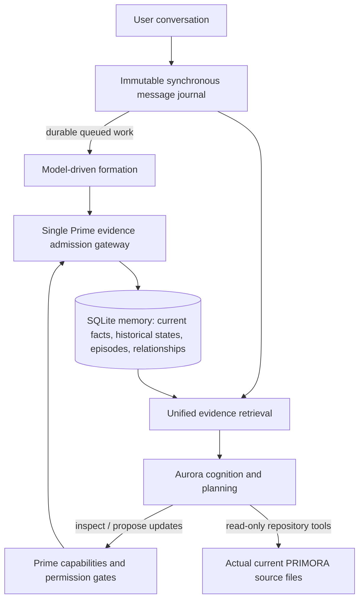

# Aurora roadmap: Memory Unification -> Cognition -> Multimodal Verse

Status: approved architecture direction on 2026-10-27. This document is a *plan*, not proof of implementation.
Owner: PRIMORA / Aurora. Integration branch: `milestone/memory-unification`.
Implementation issue: #6. Safety blocker: #5. Memory evaluation: #4. Cognition issue: #3.

## Core architecture principle

Aurora (LLM) proposes meaning, links evidence, chooses investigations and explains uncertain results.
Prime (deterministic runtime) controls permissions, source ownership, scope, validated memory writes,
quotas, task execution, structured records, and recoverability. Neither side should
hardcode topic-specific conversational answers or presumed facts about PRIMORA.

## Memory integration: M10 (one coherent implementation)

1. **Fix authority first.** Any user-authority memory must reference a verified original user turn.
   Assistant claims and tool results may be stored under distinct namespaces, never as user facts.
   Resolve issue #5 and unsupported rationale formation; truthful saved/pending/failed feedback.
2. **Remove write-path overlap.** Put model proposals, deterministic compatibility extraction,
   learning and working-memory promotion through one admission service. Use adapters for legacy
   callers, not simultaneous independent writers.
3. **Mem0-inspired deferred processing.** Journaling is synchronous and idempotent; durable
   formation jobs run after the turn when configured, with retry status and restart recovery.
   Preserve a synchronous drain mode for tests. Latest raw user messages stay retrievable while
   processing lags. Respect local model resource constraints.
4. **Graphiti-inspired temporal evidence.** Use existing observed/report/valid timestamps,
   immutable sources, supersession history, entity and relationship links; no second DB.
5. **Letta-inspired agent memory maintenance.** Aurora may search, inspect, propose and review
   memory changes. Prime independently verifies evidence and approvals. Background consolidation
   must be bounded, observable and restart-safe.
6. **One retrieval evidence envelope.** Verified source role, message ID, validity, current status,
   confidence, origin, evidence omissions. Use existing hybrid retrieval and reduce duplicate
   intent heuristics; language understanding stays with the model.

### M10 acceptance gate

- **Zero** current user-authority facts from assistant/tool/system-only evidence.
- **Zero** unsupported user-stated rationale or unsupported hypothetical fact admission.
- Every claimed successful durable write is supported by a committed stored row; held != learned.
- Restart after interrupted queued formation resumes exactly once; raw user history remains intact.
- Corrections preserve history; provenance holds through duplicated/superseded/merged updates.
- Real-Qwen, held-out multi-session evaluation with exact counts, >=95% grounded answers as
  an advance-set target (meaningful sample size required), 0 trust violations, performance
  separately reported for reply latency and formation lag.
- Legacy and new tests run without weakening unrelated safety regressions. Production DB untouched.

**Go/No-go:** Do not wait for literally perfect recall; pass the security/provenance and
durability invariants, then enter Phase 2 and continue non-blocking memory refinements alongside it.

## Next phases and demonstrable exits

| Order | Phase | Aurora can demonstrably do | Acceptance evidence |
| --- | --- | --- | --- |
| Now | M10 memory unification | Recall, correct, and verify sources across sessions, without inventing authority | Baseline pass, Qwen gate, audited DB, restart |
| 2A | C1 repository understanding | Inspect current source to map PRIMORA architecture, cite files/lines, admit unknowns | Read-only tools, changed/renamed file challenges, injection/security tests |
| 2B | C2 cognition/planning | Break an open task into steps; check evidence, recover from error, resume | Multi-step live tasks, checkpoint/restart and verification traces |
| 3 | Multimodel delegation | Choose specialists (coding, reasoning, research, optional image/audio/video) while preserving Aurora identity | Controlled registry, routing accuracy, usage budget, tool fallback |
| 4 | Autonomous development | Propose isolated repo edits, run tests, show diff, request approval before consequences | Source-based change, passing tests, user-approved apply/merge |
| 5 | Multimodal perception | Observe screen/audio/camera on permitted modes; quiet Observer mode accumulates context | Explicit controls, privacy gates, delayed grounded answers |
| 6 | Verse presence | Aurora co-creates an abstract shared digital cyberspace with visible form and environment control | Real interactive, transformable Verse demos, permission controls |

Phases 2A/2B can refine noncritical memory defects as needed; do not loop indefinitely on
memory features. Code-exploration knowledge is generated by inspecting the *current repository*,
never by prompts hardcoding PRIMORA's component inventory.

## Inspirations and differences

- Mem0 memory processing architecture: https://github.com/mem0ai/mem0/blob/main/skills/mem0/references/architecture.md
- Graphiti temporal knowledge graph: https://www.getzep.com/platform/graphiti/
- Letta MemFS/dreaming: https://github.com/letta-ai/letta-docs-md/blob/main/configuration/memory/index.md

We are adopting **patterns**, not copying code or assuming benchmark superiority.
PRIMORA keeps its SQLite substrate and Prime/Aurora identity boundaries. For head-to-head
comparisons, evaluate identical dialogue datasets, answering model, provenance definitions,
hardware/resources and retrieval budgets; otherwise report architectural comparison only.

## Delivery rules

- One integrated Codex change on `milestone/memory-unification`, not a string of topical patches.
- No modifying or testing against production personal memories.
- One final `.patch` artifact, in-chat PowerShell apply/test commands, honest PASS/FAIL gate.
- Commit on isolated branch; do not merge without user approval.
